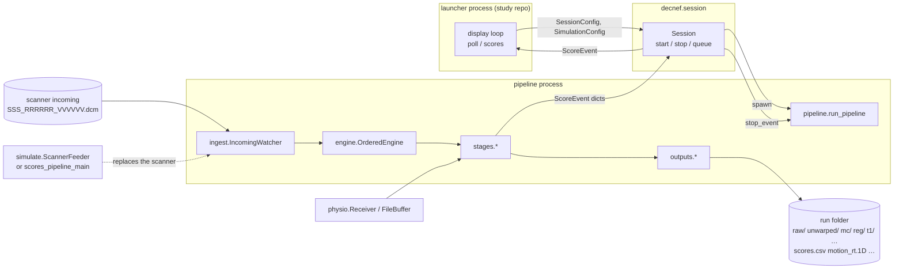
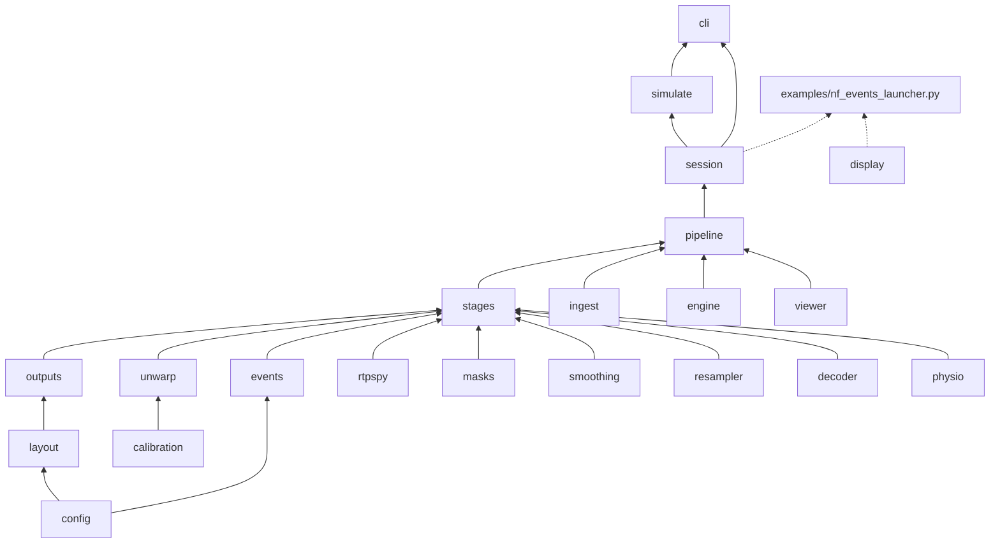

# `decnef_py` revision: changes & validation

A review document for the clean real-time package (`src/decnef/`) that
replaces the flat script tree (`rt_pipeline.py` etc). Written
2026-10-22, after the real-data equivalence check passed on the rt pc.
Everything here is reproducible from the repository
(`ericabusch/DecNef_py`, branch `master`); commands are given where useful.

---

## 1. summary

The real-time path (DICOM in → unwarp → motion correction → censoring →
nuisance regression → T1/MNI transform → mask/smooth → decoder score → event
to the display) was **moved, not rewritten**: the algorithms are the same code
(PyHySCO, RtpVolreg/librtp, RtpRegress, the GPU resampler, the decoder), now
organised as one importable package with one configuration file, one entry
point for launchers (`start_session`), explicit error handling, no module
globals and no hard-coded lab paths. On an existing 7T run the package and the
original scripts produce byte-identical outputs (scores, motion, FD,
regression status, regressors, every intermediate nifti). 
Two new tools are included: 
   1. **simulator** (fake scores, or synthetic scanner output through the
full pipeline) so launchers can be tested without a scanner
   2. **replay/compare** workflow for equivalence checks on recorded runs. 
Three bugs in the original scripts were found along the way (section 5).

Size: 6,112 lines of real-time scripts → 5,054 lines of package (of which
~600 are the simulator, which has no counterpart in the old tree).

---

## 2. What is unchanged (on purpose)

| component | source | notes |
|---|---|---|
| Fieldmap estimation | PyHySCO script, vendored (`fmri_rt_preproc/PyHySCO-main`) | same call, same parameters (GaussNewton, alpha 300, beta 1e-4, 50 iterations, `jac`) |
| Fieldmap application | `decnef.unwarp` = `pyhysco_apply.py` | numerics unchanged; cached sampling grid + Jacobian |
| Motion correction | `decnef.rtpspy.rtp_volreg` (RTPSpy + `librtp`) | same binary, same reference (`func/trans/epi_unwarped_mean.nii`) |
| FD / DVARS / censoring | `decnef.stages` = `motion_fd.py` + `rt_pipeline` | same thresholds, same +1 TR censoring |
| Nuisance regression | `decnef.rtpspy.rtp_regress` | same warm-up rule (`max(voxel_norm_ref_volumes-1, n_regressors+1)`), same polynomial order (`1 + int(TR·n/150)`) |
| Voxel normalisation (regression off) | `decnef.stages.VoxelNormalizer` | unchanged |
| EPI→T1/MNI | `decnef.resampler` = `gpu_ants_like_resampler.py` (+ `antsApplyTransforms` fallback) | same cached grid under `func/trans/gpu_grids/` |
| Final mask / smoothing | `decnef.masks`, `decnef.smoothing` | unchanged |
| Decoder scoring | `decnef.decoder` = `decoder_score.py` | ROI text or NIfTI weights; dead baseline code removed |
| Output files | `decnef.outputs` | same names and columns (`scores.csv`, `motion_rt.1D`, `fd_rt.csv`, `regressors_rt.csv`, `regression_status_rt.csv`, `scores_z.csv`, `session_metadata.json`, …) |
| Data layout | `decnef.layout` | `sub-<sub>/anat`, `<day>/fmap[/pair-apNNN_paMMM]/native_unwarp_v1`, `<day>/func/trans`, `<day>/func/<run>/{raw,unwarped,mc,reg,t1|mni,…}` |
| Processing order | `unwarp_then_mc_v1` | the September 2026 upstream order (unwarp before MC); recorded in `preprocessing_order.json` and refused if a run folder disagrees |

---

## 3. What changed

### 3.1 Structure

| before | after |
|---|---|
| ~15 top-level modules importing each other by bare name; only an editable install works | `src/decnef/` package, `pip install -e .` or a wheel; every module imports from outside the repo |
| `rt_global_settings.REGRESSOR_SETTINGS` module global + per-launcher argparse + defaults hidden in code | `decnef.config.Settings`: one YAML/JSON per study, validated at load; `--set key=value` overrides; `decnef config migrate` converts an old `*_settings.json`; `decnef config show` prints the effective tree |
| `RTSessionConfig` path properties that `mkdir` on access | `RunLayout`: pure paths, `create_run_dirs()` explicit |
| One 2 300-line `rt_pipeline.py` | `ingest` (DICOM watch + convert) · `engine` (parallel compute, ordered commit) · `stages` (one function per stage, `RunState`) · `pipeline` (prerequisites, provenance, state build, run loop) · `outputs` · `calibration` · `masks` · `smoothing` · `unwarp` · `resampler` · `physio` · `viewer` · `decoder` |
| Launchers copy ~200 lines of process management each | `decnef.session.start_session(cfg)`: a context manager that starts the pipeline, physio, extra processes; the launcher only owns the display (`examples/nf_events_launcher.py`, 195 lines) |
| `python rt_pipeline.py …`, `replay_run.py`, `compare_scores.py` | `decnef run / replay / simulate / compare / calibrate / config`, with `@file` argument files |

### 3.2 Behaviour (intentional differences)

| topic | old | new |
|---|---|---|
| Failed volume | silent fallback (zeros / un-regressed volume could be scored) | the stage raises; the volume is recorded as failed and the display receives `kind="error"` for it; nothing is substituted |
| `skip_first_trs` | two meanings (pipeline `pre_trial_scans` vs display `--skip-first-trs`) | one setting, used by FD/censoring, stage labels and the launcher |
| `reg_ready` | sometimes missing from messages; launchers disagreed on the default | always present on every score; a launcher uses only `reg_ready=True` scores |
| Score events | ad-hoc dicts | `ScoreEvent` with mandatory `kind` (`tick/score/scorer/error/end`) and `source` |
| TR | config or hard-coded 1.4 in places | config only |
| Trial-stage labels | derived inside launchers | `settings.stages` → `StageSchedule`; `scores.csv` `event_type` and every event carry the label |
| Startup | listed the incoming folder, built state (seconds), then armed the watcher — volumes arriving in between were lost | folder re-listed after the watcher is armed (section 5) |
| Linux file events | `created`/`closed` only | also `moved-to` (files renamed into the folder) |
| Fieldmap calibration missing | built at startup (`ensure_fieldmap_only`) | same, via `calibration.build_native_calibration`; also `decnef calibrate` to do it explicitly |
| Shutdown | varied per launcher; unbounded joins | `Session.stop()`: stop event → join → terminate → kill, extras first, physio last; `q`/Esc in the display |
| Logging | `logging.basicConfig` at import, `print` | module loggers only; the CLI configures logging |
| PyQt5 / pyserial / six | hard imports in RTPSpy | optional (`decnef.rtpspy._qt`), six removed |
| Lab specifics | `/home/sin/...`, `/SSD2/...`, BIOPAC IP, default NSF decoder in code | none in the package; the lab's five settings files live in `configs/*.yaml` |

### 3.3 New

- **Simulator** (`decnef.simulate`): `start_session(cfg, simulate=SimulationConfig(level="scores"|"scanner"))`.
  *scores*: a fake pipeline process emitting one `ScoreEvent` per TR with the
  right stage labels and `reg_ready` timing, no tools. *scanner*: a phantom
  (reference EPI, masks, PyHySCO calibration on the staggered grid, decoder,
  identity GPU grid) and synthetic Siemens-mosaic DICOMs (drift, rigid jitter,
  a motion spike at volume 15, noise, a signal injected in the decoder's
  positive voxels during chosen stages) fed at the TR through the **real**
  pipeline. Never writes under the study's `base_data`.
- **Replay**: `decnef replay` copies a subject's prepared data (`anat/`,
  `fmap/`, `func/trans/`, reference run) into an output directory, feeds a
  recorded run's DICOMs at a chosen pace, runs the real pipeline on the copy.
  `decnef compare` diffs the outputs of two runs (timestamps ignored).
- **Launcher dry run**: `examples/nf_events_launcher.py --simulate scores|scanner`.
- **Argument files**: `decnef replay @examples/replay_99988.args`.

---

## 4. How the pieces interact

### 4.1 Processes at run time

```text
launcher (main process: PsychoPy display; reads ScoreEvents via session.scores()/poll())
│
├── pipeline process      decnef.session._pipeline_main → decnef.pipeline.run_pipeline
│   ├── watchdog observer   incoming folder (created / closed / moved-to events)
│   ├── thread pool         decnef.engine: dcm2niix per volume, any order
│   ├── ordered commit      stages in scan order: unwarp → MC → censor → regress → transform → smooth → score
│   ├── BIOPAC receiver     physio.mode = tcp (thread)
│   └── QC viewer           qc.volume_viewer (daemon process, matplotlib)
│
├── physio listener       physio.listener (writes the CSV the pipeline tails)
├── extras                one process per ProcessSpec (e.g. a PCA scorer plugin)
└── [simulation only]     ScannerFeeder thread (DICOMs at the TR) or the fake scores pipeline
```



### 4.2 Per-volume data flow (ordered commit)

```mermaid
flowchart TD
    A[DICOM file] -->|ingest.convert_dicom · dcm2niix| B[raw/vol_v.nii]
    B -->|unwarp_stage · PyHySCO field, grid/polarity/readout checks| C[unwarped/vol_v_uw_native.nii]
    C -->|motion_stage · RtpVolreg vs reference| Dm[mc/vol_v_mc.nii · motion_rt.1D · fd_rt.csv]
    Dm -->|censor_stage · DVARS, FD flags +1 TR| E2[dvars_rt.csv]
    Dm -->|regression_stage · RtpRegress: mot6 + WM + Vent (+GS, physio) + poly, or voxel-norm| F[reg/vol_v_reg.nii · regressors_rt.csv · regression_status_rt.csv]
    F -->|transform_stage · GPU grid or antsApplyTransforms| G[t1/ or mni/ vol_v_space.nii]
    G -->|smooth_stage · final mask, optional FWHM| H[smooth/ or masked/]
    H -->|score_stage · decoder · StageSchedule · z reference| I2[scores.csv · scores_z.csv · ScoreEvent]
```

A stage that cannot do its job raises; the engine marks the volume failed and
the display sees `kind="error"` for that `volume_idx`. Scans the watcher saw
but that never arrive are skipped after `commit_wait_timeout_s` once a newer
scan is ready; late results for a committed scan are dropped.

### 4.3 Module dependencies



Arrows read "is used by". `tools` (which/run) is used everywhere; `display`
(PsychoPy helpers: window, trigger wait, stop keys, acquisition-speed log)
is the only module that imports PsychoPy, and only when a launcher does.

### 4.4 Run start (`pipeline.run_pipeline`)

1. `check_prerequisites` — tools on PATH, incoming folder, reference EPI,
   fieldmap calibration (built from raw AP/PA if missing), decoder. Fails
   here, not at volume 1.
2. `validate_run_provenance` — `preprocessing_order.json` (order,
   calibration identity, reference, phase encoding, final mask). A run folder
   with a different marker, or with processed volumes already, is refused.
3. `build_state` — reference, cached PyHySCO applier, RtpVolreg, DVARS mask,
   physio, RtpRegress + nuisance masks, GPU grid, smoother, decoder, stage
   schedule, z reference stats.
4. `session_metadata.json` — pipeline keys + the full settings tree; a
   launcher's keys and the `simulation` block are merged in.
5. Volumes already in the folder are processed first; the watcher is armed
   **before** the folder is re-listed; the BIOPAC `run_start` goes out on the
   first online volume.

---

## 5. Bugs found in the original scripts

Found because the package was compared against them; none are fixed in the
old tree.

| bug | effect | how it was found | status |
|---|---|---|---|
| **Startup gap**: `rt_pipeline.py` lists the incoming folder, spends 1–2 s building state, then starts the watchdog observer. A DICOM landing in between is never processed. | A run started while the scanner is already writing silently loses volumes (the row numbering stays consistent, so nothing flags it). At the scanner the pipeline is normally started first, which is why it went unnoticed. | Linux replay at the real TR: volume 2 missing from the legacy run (39 rows vs 40). Deterministic test: `test_volume_arriving_during_startup_is_not_lost`. | fixed in the package (folder re-listed after the observer starts); **open upstream** |
| **Renamed files are invisible on Linux**: the watcher handles `created`/`closed` only; a file moved into the folder (inotify `IN_MOVED_TO`) is ignored. | Does not affect the scanner (it writes files) but any tool that stages and renames (replay, simulator, some DICOM forwarders) stalls at 0 volumes. | The simulator on the lab machine: pipeline alive, no volumes. | fixed in the package; **open upstream** |
| **Replay pacing changed the numerics**: in the first package version `--tr` also overrode `pipeline.TR`, and RtpRegress's polynomial order is `1 + int(TR·n/150)`. | 42 vs 15 polynomial columns at `--tr 3.0`; over a long run the regression would differ. | Diffing `regressors_rt.csv` after the IDENTICAL check. | fixed (pacing and pipeline TR are separate); the old `replay_run.py` never had this issue |

Also observed, not bugs: raw AP/PA in the lab's `fmap/` folders have no JSON
sidecars, so both trees fall back to phase-encoding axis 2 with a warning; the
lab's existing subjects were prepared before the `native_unwarp_v1/`
calibration existed, so both trees build it at startup from `AP/PA.nii.gz`.

---

## 6. Validation so far

### 6.1 Unit and behaviour tests (`tests/decnef`, 73 tests, ~90 s; plus the 97 old-tree tests)

| file | n | covers |
|---|---|---|
| `test_config_layout_outputs.py` | 19 | config load/validate/override/migrate (incl. the lab's five settings files), layout paths, output writers, decoder parsing, events, watcher events (created/closed/moved), argument files |
| `test_engine.py` | 4 | ordered commit, out-of-order arrival, commit-wait timeout, late results dropped |
| `test_stages_pipeline.py` | 8 | each stage on synthetic data, EPI-space `process_volume` end to end, prerequisites, provenance refusal |
| `test_physio_smoothing.py` | 2 | BIOPAC socket round trip, smoothing numerics |
| `test_session.py` | 7 | start/stop/join/terminate order, queue, `end`/`error` events, extras |
| `test_pipeline_behaviour.py` | 10 | online ingest with out-of-order pairs, a corrupt volume reported and skipped (run continues), the session path with stage labels and metadata, the QC viewer process, **the startup-gap regression** |
| `test_nf_events_example.py` | 4 | the example launcher with a stub PsychoPy: trigger, trial windows, scores, `q` |
| `test_simulate.py` | 9 | scores level (timing, stages, `reg_ready` rule, files), out_dir reuse, mosaic DICOM round trip through dcm2niix, phantom reuse/regeneration, **scanner level through the full pipeline** (signal recovered, motion spike visible), replay staging never touches the real tree, replay of a recorded run reproduces identical scores at a different pacing, launcher `--simulate` end to end |
| `test_calibration_build.py` | 3 | PyHySCO calibration built from raw AP/PA (real PyHySCO, 3 iterations), rebuilt only when stale, built at startup by `check_prerequisites`, built in the replay copy |

### 6.2 Synthetic old-vs-new equivalence (`test_equivalence_synthetic.py`, 7 runs)

The old `rt_pipeline` and `decnef.pipeline` on the same synthetic subject
(real PyHySCO / RtpVolreg / RtpRegress; `dcm2niix` stubbed, EPI or GPU-grid MNI
space). Output CSVs **identical** for: baseline EPI run (regression active
from volume 12), final masking + smoothing, regression off (voxel
normalisation), `enable_original_score`, z-scoring against a reference run,
physio regressors in file mode with a missing volume, MNI space through the
GPU resampler.

### 6.3 Real data, lab machine (2026-10-22)

| what | result |
|---|---|
| Full test suite on the scanner computer (Linux, CUDA, `librtp.so`, conda env from `environment.yml`) | 67/67 passed (now 73) |
| `decnef replay` of sub-99988 day 8 run 4 (7T, 140×140×68, T1 space via the GPU resampler, pair ap002/pa003 calibration built by the package on the GPU in 0.25 s), 40 volumes | ran end to end, ~0.1–0.2 s compute per volume at TR 1.0 |
| Same 40 volumes through `replay_run.py --driver legacy` (old `rt_pipeline.py`) on the same copied data | `decnef compare`: **IDENTICAL** (scores, regression status, FD, motion) |
| **Full run, 600 volumes** (2026-10-23): package at the real TR (1.0 s), legacy at 3.0 s, same copied data | `decnef compare`: **IDENTICAL** — regression over the whole history, censoring, 10 minutes of real-time throughput |
| Per-volume NIfTIs `reg/`, `mc/`, `t1/` (md5) | **identical** |
| `regressors_rt.csv` | identical values; column count differed until the `--tr` fix (section 5) |
| Simulator scanner level on the lab machine | passes (synthetic DICOMs through the real pipeline, signal recovered) |

### 6.4 Not yet validated

- A second subject/config (`kostya.yaml`/`sara.yaml`: `truncate_t1_to_epi_fov`,
  two engine workers) and an **MNI-space** subject (`rt.yaml`).
- The PsychoPy display and the QC viewer on the scanner-room machine
  (`examples/nf_events_launcher.py --simulate scanner`; needs `pip install -e ".[task]"`).
- Shutdown under `q`/Ctrl-C mid-run: complete CSVs, no leftover processes, GPU memory released.
- **A live phantom/pilot scan** with `decnef run` — the only test of real
  DICOM arrival timing and the scanner's file-writing pattern.
- BIOPAC in TCP mode (only the socket round trip and file mode are tested).

---

## 7. Still outside the package

Offline preparation (`run_preproc.py`, `fmri_rt_preproc/pipeline.py`,
surface ROIs) → planned `decnef.preproc`; PyHySCO as a dependency (vendored
today); `librtp` as a build step (binaries committed today); the resting-state
PCA scorer as a plugin; the study-specific launchers (robot, BrainPong, RS);
removing the old tree and the participant data from the repository; CI and
releases. `docs/replay_check.md` lists each old file and where it goes.

---

## 8. Open questions for review

1. **Fail-loud vs fail-soft.** The package refuses to score a volume it could
   not fully process (`kind="error"` instead of a substituted value). Is
   there a paradigm where a stand-in score is preferable to a missing one?
2. **Calibration at startup.** Building the PyHySCO calibration when a run
   starts (old behaviour, kept) takes seconds on the GPU but minutes on CPU.
   Should `decnef run` refuse instead and require `decnef calibrate` beforehand?
3. **Fieldmap pair selection.** The pair is passed explicitly (`--ap-block/--pa-block`).
   The old launchers inferred it in places. Worth an "auto: latest pair
   before this run" option?
4. **Startup gap upstream.** Should the two watcher fixes be sent to
   `K-Demin/DecNef_py` as a small PR now, independently of the package?
5. **What else to compare** before the old tree is removed: is the list in
   6.4 sufficient, and which subject/config should be the second one?
6. **Simulator realism.** The phantom is a blurred ellipsoid with a smooth
   field. Is a replay of recorded data (`from_dicoms`) enough for display
   testing, or is a more realistic phantom (e.g. one built from a real
   reference EPI) worth adding?
7. **Config granularity.** One YAML per study with `--set` overrides; the
   lab currently has five files that differ in six keys (`configs/README.md`).
   Keep per-person files, or one lab file plus overrides?
